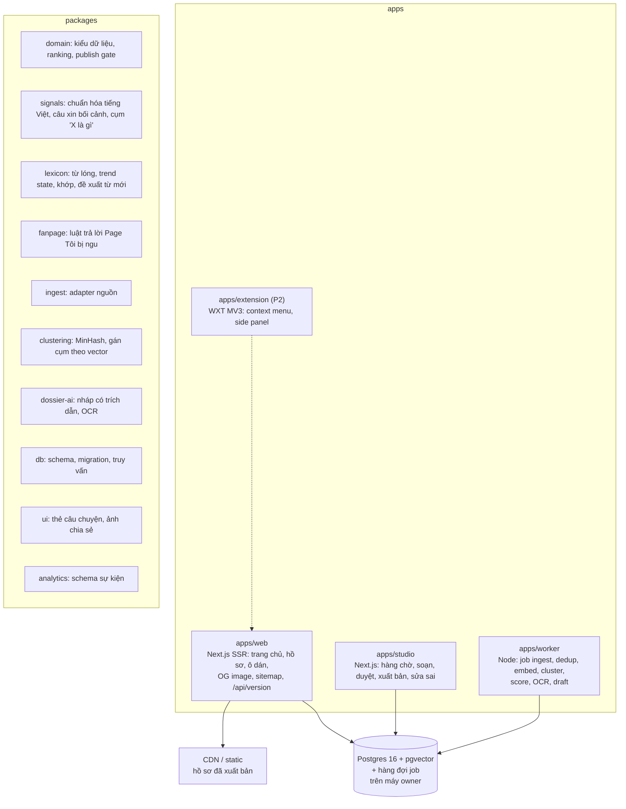

# SD-TBH001 Architecture (方式設計)

## 1. Purpose

Chốt kiến trúc container, cấu trúc repo và các quyết định công nghệ cho P1 của Toibingu, mỗi quyết định có lý do và điều kiện xem lại. Truy vết yêu cầu: RD-TBT001 (`docs/01-rd/RD-REQ/`). Ràng buộc chính: đội nhỏ (1 đến 2 biên tập viên, ít kỹ sư), pilot 8 tuần, chi phí vận hành thấp, không cào dữ liệu.

## 2. Scope

Trong phạm vi: các container P1 (web, studio, worker, Postgres, object storage), các package dùng chung, luồng dữ liệu chính. Ngoài phạm vi: thiết kế màn hình chi tiết (02-bd), schema cột và API chi tiết (03-dd), extension và đóng góp cộng đồng (P2, chỉ giữ chỗ).

## 3. Container view (C4 L2)



## 4. Main flows

1. **Khám phá (REQ-009):** worker kéo nguồn theo lịch, chuẩn hóa, loại trùng (MinHash), nhúng vector, gán vào story candidate gần nhất hoặc tạo mới, cập nhật tín hiệu theo cửa sổ 15 phút, tính `priority()`.
2. **Ô dán (REQ-003):** web nhận URL / văn bản / ảnh. URL: chuẩn hóa và tra khớp trực tiếp; văn bản: chuẩn hóa dấu, tìm lai (trigram + vector) trên tiêu đề, alias, mục giải mã; ảnh: OCR rồi như văn bản. Không khớp: ghi context request, trả lời trung thực.
3. **Biên tập (REQ-010):** biên tập viên mở candidate, yêu cầu nháp AI (mọi câu kèm source id), sửa, duyệt; Studio gọi `checkPublishGate()`; khi pass, tạo phiên bản bất biến và trỏ bản xuất bản; web làm mới cache trang đó.
4. **Chia sẻ (REQ-007):** route OG sinh ảnh 1200×630 từ phiên bản đang xuất bản, có cache theo phiên bản; link mang mã giới thiệu ẩn danh.

## 5. Design decisions

| Mã | Quyết định | Lý do (ROI) | Xem lại khi |
|---|---|---|---|
| H-01 | Monorepo pnpm, TypeScript cho toàn bộ P1 (web, studio, worker) | Một ngôn ngữ cho đội nhỏ; dùng chung kiểu `domain` giữa web/studio/worker | Cần BERTopic, HDBSCAN, underthesea ở quy mô lớn (xem H-06) |
| H-02 | Next.js App Router, render phía server | SEO (REQ-012), LCP (NFR-02), OG image sẵn (`next/og`) | Chi phí hosting vượt ngân sách |
| H-03 | Studio là ứng dụng riêng, không phải route trong web | Tách ranh giới tin cậy TB-2, deploy và phân quyền độc lập | Không |
| H-04 | Postgres 16 + pgvector là kho duy nhất; hàng đợi job trên Postgres (pg-boss) | Một hệ quản trị cho dữ liệu, vector, job; ít vận hành | > 1 triệu post/ngày hoặc độ trễ hàng đợi > 5 phút |
| H-05 | Xếp hạng và publish gate là hàm thuần trong `packages/domain`, có test | Luật cốt lõi (độ tin cậy là cổng, không là trọng số; repost không cộng dồn) bị khóa bằng test, dùng chung ở mọi app | Không; đổi luật = đổi test + RD |
| H-06 | Gom cụm P1: MinHash loại trùng, rồi gán vào cụm có tâm gần nhất nếu cosine ≥ ngưỡng, ngược lại tạo candidate mới; biên tập viên gộp / tách tay | Dễ giải thích, đủ cho < 10.000 post/ngày; không cần dịch vụ Python | Precision gom cụm < 85% trên bộ có nhãn, hoặc > 50.000 post/ngày: thêm dịch vụ Python (BERTopic + HDBSCAN + underthesea) |
| H-07 | Chuẩn hóa tiếng Việt P1 tự viết trong `packages/signals` (NFC, bỏ dấu, gộp teen-code phổ biến) | Đủ cho khớp mẫu câu xin bối cảnh; không phụ thuộc Python | Recall bộ nhận diện < 80% trên bộ có nhãn |
| H-08 | LLM chỉ soạn nháp và OCR; không xuất bản, không chấm nhãn xác minh | Giữ trách nhiệm biên tập; tránh tin đồn được "AI xác nhận" | Không ở P1 |
| H-09 | Nhà cung cấp LLM và embedding qua interface trong `packages/dossier-ai` | Đổi nhà cung cấp theo giá / chất lượng tiếng Việt mà không sửa app | Đánh giá chất lượng tiếng Việt ở 02-bd |
| H-10 | Không dùng mô hình gốc PhoBERT-base-v2 (AGPL-3.0) và các mô hình dẫn xuất | Rủi ro giấy phép cho sản phẩm thương mại | Có ý kiến pháp lý khác |
| H-11 | Sự kiện đo lường ghi vào Postgres (bảng sự kiện riêng), dashboard SQL | Không chuyển dữ liệu người dùng cho bên thứ ba ở P1; đủ cho pilot | > 5 triệu sự kiện/tháng |
| H-12 | Extension P2 dùng WXT, bắt đầu từ mẫu `sample.sidepanel-dictionary`, fallback popup cho Cốc Cốc | Framework MV3 đang duy trì, MIT | Cốc Cốc chặn API cần thiết |
| H-13 | Mọi app có `/api/version` trả commit sha và thời điểm build | Biết bản nào đang chạy (thang release, harness L9) | Không |
| H-14 | Dữ liệu (Postgres, object storage, worker) chạy trên **máy local của owner** (owner chốt 2026-10-16). Hồ sơ đã xuất bản được render thành trang tĩnh đẩy lên CDN; ô dán và Studio đi qua tunnel tới máy owner | Owner giữ dữ liệu; việc đọc không phụ thuộc máy owner đang bật (NFR-03) | Lưu lượng ô dán vượt khả năng máy owner, hoặc máy owner offline > 1 giờ/tuần |
| H-15 | Lexicon P1 là dữ liệu JSON có review trong repo (`data/lexicon/`), kiểm bằng `validateLexicon`; nhập vào Postgres khi có `packages/db` | Mỗi thay đổi nghĩa từ có diff, người duyệt, lịch sử (PR); không cần UI Studio để bắt đầu | Hơn 2.000 mục hoặc hơn 50 thay đổi/ngày |
| H-18 | Pilot giai đoạn đầu: hồ sơ là dữ liệu JSON duyệt qua PR (`data/dossiers/`), `apps/web` sinh trang tĩnh không phụ thuộc thư viện (trang chủ, `/vu/<slug>/`, `/api/version.json`). Build công khai bỏ bản nháp và **dừng build** nếu hồ sơ đánh dấu xuất bản mà không qua `checkPublishGate`; build `--preview` hiện bản nháp kèm băng "BẢN NHÁP" và `noindex` | Ra trang đọc được nhanh nhất để đo giả thuyết pilot; khớp H-14 (trang tĩnh trên CDN); chưa cần Postgres, Studio hay Next.js | Cần ô dán (REQ-003), phản hồi (REQ-008) hoặc > 50 hồ sơ/tuần: thêm API + Studio theo H-02, H-03 |
| H-17 | Bot Page "Tôi bị ngu": quyết định trả lời là hàm thuần trong `packages/fanpage` (`decideReply`, `decideMention`); `apps/page-bot` (webhook receiver chạy trên máy owner qua tunnel) chỉ nhận sự kiện, gọi quyết định, hẹn giờ gửi qua Graph API | Luật trả lời (trễ, giới hạn, không trích hồ sơ chưa xuất bản) khóa bằng test, đổi nền tảng không đổi luật | Meta đổi chính sách Page/Messenger |
| H-16 | Skill `toibingu-trend-scout` (agent chạy định kỳ) chỉ **đề xuất** vào `data/lexicon/proposals/`; duyệt là việc của biên tập viên. Mức nóng (`trendState`) và duyệt (`isPublic`) là hai hàm tách biệt | Giữ nguyên tắc H-05 cho từ lóng: nóng không mở được cổng công khai | Không |

## 6. Repository layout

```
apps/web  apps/studio  apps/worker  apps/extension (P2)
packages/domain  packages/signals  packages/lexicon  packages/ingest  packages/clustering
packages/dossier-ai  packages/db  packages/ui  packages/analytics
data/lexicon (terms.json, proposals/)
docs/00-intake  docs/01-rd  docs/01-sd  docs/02-bd (sau)  docs/03-dd (sau)
scripts/harness  scripts/ci  tests/harness  .nexa
```

Thứ tự hiện thực: `domain`, `signals`, `lexicon` (đã có test) trước, rồi `db`, `ingest`, `clustering`, `worker`, `web`, `studio`, `dossier-ai`, `ui`, `analytics`. Package chưa có code thì chưa tạo thư mục.

## 7. Non-functional, integration, data

NFR: SD-TBN001. Integration: SD-TBI001. Data architecture: SD-TBY001. Common policy: SD-TBP001.
