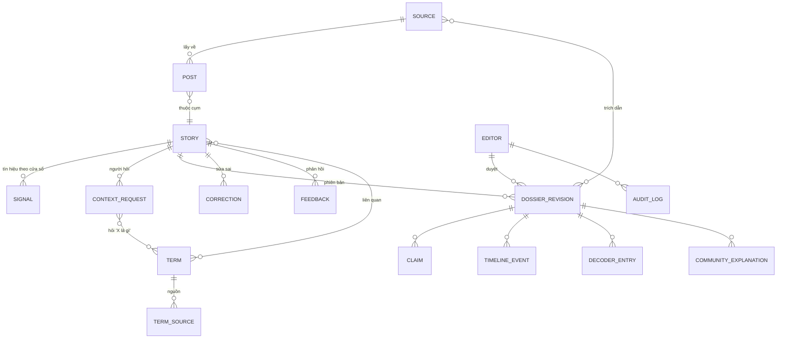

# SD-TBY001 Data architecture

## 1. Purpose

Định nghĩa các thực thể dữ liệu ở mức hệ thống, quan hệ, vòng đời, phiên bản và thời hạn lưu. Schema cột cụ thể thuộc 03-dd. Truy vết: RD-TBT001 REQ-002, REQ-004, REQ-005, REQ-008, REQ-011, REQ-013, NFR-04, NFR-07 (`docs/01-rd/RD-REQ/`). Kiểu dữ liệu lõi đã khóa trong `packages/domain/src` (`Story`, `CatchUpDossier`, `Claim`, `Source`).

## 2. Scope

Dữ liệu lưu trong Postgres (SD-TBH001 H-04) và object storage tạm. Không gồm log hạ tầng.

## 3. Entities

| Thực thể | Nội dung chính | Vòng đời / ghi chú | RD |
|---|---|---|---|
| Source | URL, nền tảng, `visibility`, `accessMethod`, thời điểm lấy | Bất biến sau khi tạo; private không được trích công khai | REQ-005, NFR-05 |
| Post | Nội dung ngắn đã chuẩn hóa, cộng đồng, chữ ký MinHash, vector, thời điểm | Văn bản thô giữ 30 ngày, sau đó chỉ giữ URL + mã băm + vector | REQ-009 |
| Story | Slug, tiêu đề câu hỏi, trạng thái (`candidate`, `drafting`, `in_review`, `published`, `archived`), cộng đồng gốc, nơi đang lan, alias | Slug ổn định suốt đời; gộp / tách bởi biên tập viên có audit | REQ-001, REQ-004 |
| Signal | Đếm theo cửa sổ 15 phút: theo nguồn × cộng đồng, số câu xin bối cảnh, baseline của nguồn | Giữ 90 ngày chi tiết, sau đó gộp theo ngày | REQ-009 |
| ContextRequest | Mã băm văn bản đã chuẩn hóa, URL (nếu có), mã băm thiết bị, story khớp, độ khớp | Không lưu văn bản gốc quá 30 ngày; đếm "người độc lập" theo mã băm thiết bị | REQ-003, REQ-012 |
| DossierRevision | 6 phần hồ sơ, người duyệt, thời điểm biên soạn / cập nhật, mô tả thay đổi | **Bất biến**; story trỏ tới phiên bản đang xuất bản; lịch sử công khai | REQ-004, REQ-011, NFR-07 |
| Claim | Văn bản, nhãn (`circulating`, `confirmed`, `disputed`, `debunked`), source ids | Thuộc một phiên bản; đổi nhãn = phiên bản mới | REQ-005 |
| TimelineEvent | `happenedAt`, `knownAt` tách riêng, source ids | Thuộc một phiên bản | REQ-004 |
| DecoderEntry | Cụm từ, nghĩa, source ids | Thuộc một phiên bản; dùng làm alias cho ô dán | REQ-003, REQ-004 |
| CommunityExplanation | Trích ≤ 280 ký tự, source id, người chọn | Thuộc một phiên bản | REQ-006 |
| Correction | Báo sai, trạng thái xử lý, phiên bản sửa | Công khai dạng nhật ký khi đã xử lý | REQ-008, NFR-06 |
| Feedback | Phản hồi thẻ (3 nút) và hồ sơ (3 nút), mã băm thiết bị | Gộp sau 13 tháng | REQ-002, REQ-008 |
| Event | Sự kiện đo lường ẩn danh (danh sách ở REQ-013), mã giới thiệu | Chi tiết 13 tháng, sau đó gộp | REQ-013 |
| Editor, AuditLog | Tài khoản Studio, vai trò; mọi hành động soạn / duyệt / xuất bản / gộp | Audit giữ tối thiểu 24 tháng | REQ-010, NFR-07 |
| Screenshot (object storage) | Ảnh người dùng tải lên ô dán | **Tự xóa sau 24 giờ** | REQ-003, NFR-04 |
| Term | Dạng chuẩn có dấu, biến thể, `accentedOnly`, loại (slang, catchphrase, nickname, hashtag, brand), nghĩa ≤ 200 ký tự, cộng đồng, nền tảng, `evergreen`, `sensitive`, trạng thái duyệt, người duyệt, story liên quan | P1 lưu ở `data/lexicon/terms.json` (H-15); trạng thái nóng tính lại mỗi chu kỳ, không lưu tay; kiểu `Term` trong `packages/lexicon` | REQ-017 |
| TermProposal | Đề xuất mục mới hoặc sửa từ skill trend-scout hoặc từ `discoverCandidates` (số người hỏi độc lập, cộng đồng, nguồn) | `data/lexicon/proposals/<ngày>.json`; xóa sau khi duyệt hoặc từ chối (lịch sử còn trong git) | REQ-017 |

## 4. Design decisions

| Mã | Quyết định | Lý do |
|---|---|---|
| Y-01 | Hồ sơ là chuỗi phiên bản bất biến, story trỏ tới phiên bản xuất bản | Truy vết, "có gì mới so với lần trước", rollback nội dung |
| Y-02 | Nhãn claim nằm trong phiên bản, không cập nhật tại chỗ | Lịch sử xác minh minh bạch |
| Y-03 | Không lưu văn bản người dùng trong bảng sự kiện; định danh thiết bị chỉ lưu dạng mã băm có muối xoay vòng theo quý | Quyền riêng tư (NFR-04) nhưng vẫn đếm được "người độc lập" |
| Y-04 | Vector lưu cạnh dữ liệu (pgvector), không dùng vector DB riêng | Một kho, ít vận hành (H-04) |
| Y-05 | Slug tiếng Việt không dấu, ổn định; đổi tiêu đề không đổi slug | Link chia sẻ và SEO không gãy |
| Y-06 | Toàn bộ dữ liệu nằm trên máy owner (H-14); sao lưu mã hóa hằng đêm ra một đích owner chọn | Máy local là điểm hỏng đơn |

## 5. Integration and NFR notes

Nguồn đầu vào của Post, Signal: SD-TBI001. Thời hạn lưu và cảnh báo xóa ảnh: SD-TBN001.
