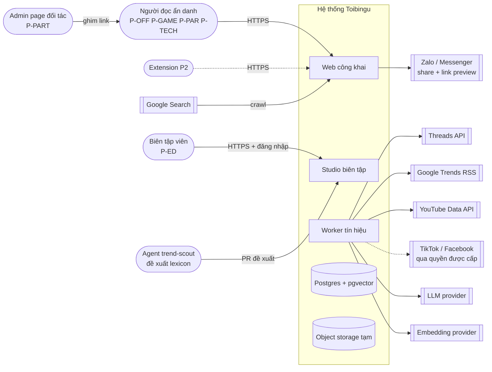

# SD-TBX001 System Context

## 1. Purpose (Mục đích)

Xác định ranh giới hệ thống Toibingu, các tác nhân và hệ thống ngoài, và các ranh giới tin cậy. Tài liệu này là gốc cho SD-TBH001 (Architecture) và SD-TBI001 (Integration). Yêu cầu nguồn: `docs/01-rd/RD-REQ/RD-TBT001-customer-requirements.md` (RD-TBT001).

## 2. System boundary (Ranh giới hệ thống)

**Bên trong ranh giới:** web công khai, Studio, worker, cơ sở dữ liệu, object storage tạm cho ảnh chụp, lexicon. Dữ liệu chạy trên máy local của owner; trang đã xuất bản đặt trên CDN (SD-TBH001 H-14).
**Bên ngoài ranh giới:** mạng xã hội (chỉ qua API chính thức), Google Trends RSS, nhà cung cấp LLM và embedding, ứng dụng nhắn tin nhận link chia sẻ, máy tìm kiếm.

## 3. Actors (Tác nhân)

| Tác nhân | Vai trò | Xác thực | RD |
|---|---|---|---|
| Người đọc | Xem trang chủ, dán link/câu/ảnh, đọc hồ sơ, phản hồi, chia sẻ, theo dõi vụ | Không; định danh thiết bị ẩn danh | REQ-001 đến REQ-013 |
| Biên tập viên | Chọn chuyện, soạn, duyệt, xuất bản, sửa sai | Đăng nhập + vai trò | REQ-010 |
| Biên tập viên chính | Như trên + duyệt bản cuối, quản lý nguồn, xử lý báo sai | Đăng nhập + vai trò | REQ-010, NFR-07 |
| Admin | Quản lý tài khoản Studio, cấu hình nguồn, trần chi phí | Đăng nhập + vai trò | NFR-08, NFR-10 |
| Page đối tác | Dẫn link tới hồ sơ | Không (ngoài hệ thống) | K7 |
| Extension (P2) | Gửi đoạn người dùng chủ động chọn | Không; `activeTab` | REQ-015 |
| Agent trend-scout | Đề xuất mục lexicon kèm nguồn; không duyệt | Repo (PR) | REQ-017 |

## 4. Trust boundaries (Ranh giới tin cậy)

- **TB-1 Internet / web công khai:** mọi đầu vào từ người đọc là không tin cậy (URL, văn bản, ảnh). Kiểm tra kích thước, loại tệp, giới hạn tần suất theo thiết bị và IP.
- **TB-2 Studio:** chỉ tài khoản biên tập; tách ứng dụng khỏi web công khai để thu hẹp bề mặt tấn công.
- **TB-3 Worker sang hệ thống ngoài:** nội dung lấy về từ mạng xã hội và nội dung LLM sinh ra là **dữ liệu**, không bao giờ là lệnh; LLM không có quyền xuất bản.
- **TB-4 Nhóm riêng tư:** nội dung từ nhóm riêng tư không được trở thành Source công khai (publish gate chặn `visibility = private`).

## 5. Design decisions at context level (Quyết định thiết kế)

| Mã | Quyết định | Lý do | RD |
|---|---|---|---|
| X-1 | Kênh P1 duy nhất là web tối ưu điện thoại; không app native | Cửa vào qua link chia sẻ Zalo/Messenger và Google; không bắt cài | REQ-001, REQ-007, REQ-012 |
| X-2 | Không đăng nhập người đọc ở P1 | Giảm ma sát; tránh rủi ro Nghị định 147 khi chưa mở đóng góp | NFR-01, Q-01 |
| X-3 | Chỉ API chính thức, link người dùng gửi, link biên tập viên thêm | Điều khoản nền tảng; nhãn phạm vi trung thực | NFR-05, REQ-009 |
| X-4 | Extension là client của web API, không có backend riêng | Một nguồn sự thật cho matching và hồ sơ | REQ-015 |

## 6. Non-functional and integration notes

Chi tiết NFR ở SD-TBN001, integration ở SD-TBI001, data architecture ở SD-TBY001.
